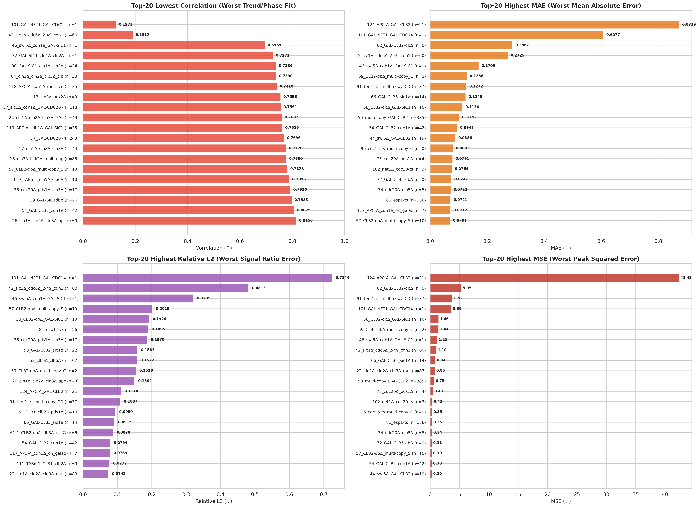

# MASS v2 数据集下各评估指标 Top-20 最差 Badcase 全景统计大字典

> **生成时间**: 2026-08-23 00:39:16  
> **评测模型**: `biom_refiner_graph_none_hybrid_mse_rel_massv2_biom_refiner_graph_hybrid_width128_modes32_seed42`  
> **数据集**: `mass_v2_dataset_210min_500steps_dual_labels.npz` (80K 训练集, seed=42)  
> **报告目录**: `budding_yeast_v2/data/dataset_analysis/`

---

## 🖼️ 四大指标 Top-20 全景可视化图谱

---

## 1. 最差【相关性 Correlation】Top-20 排行榜 (反映波形趋势与相位失真)
*相关性越低，说明模型对该突变体的周期振荡相位或波形趋势预测越差。*

| 排名 | 突变体编号与名称 | 碳源 | 突变基因数 | **Correlation (↑)** | Correlation | Relative L2 | MAE | 80K 训练集精确样本数 | 80K 训练集子集覆盖数 | 141维 k-NN 距离 | 根因归属诊断 |
| :---: | :--- | :---: | :---: | :---: | :---: | :---: | :---: | :---: | :---: | :---: | :--- |
| 1 | `101_GAL-NET1_GAL-CDC14` | Gal | 2 | **0.1273** | 0.1273 | 0.7244 | 0.6077 | **1** | 2295 | 1.27 | 🚨 Extreme Scarcity (<10 Exact Training Samples) |
| 2 | `42_sic1Δ_cdc6Δ_2-49_cdh1Δ_GAL-CDC20` | Gal | 4 | **0.1912** | 0.1912 | 0.4813 | 0.2725 | **60** | 122 | 0.98 | 🏜️ High-Dimensional Parameter Isolation (k-NN Sparse) |
| 3 | `46_swi5Δ_cdh1Δ_GAL-SIC1` | Gal | 3 | **0.6959** | 0.6959 | 0.3209 | 0.1705 | **1** | 709 | 1.37 | 🚨 Extreme Scarcity (<10 Exact Training Samples) |
| 4 | `32_GAL-SIC1_cln1Δ_cln2Δ_cdh1Δ` | Gal | 3 | **0.7271** | 0.7271 | 0.0375 | 0.0149 | **1** | 646 | 1.12 | 🚨 Extreme Scarcity (<10 Exact Training Samples) |
| 5 | `30_GAL-SIC1_cln1Δ_cln2Δ` | Gal | 2 | **0.7386** | 0.7386 | 0.0175 | 0.0060 | **34** | 2338 | 0.71 | Moderate Fitting Challenge |
| 6 | `64_cln1Δ_cln2Δ_clb5Δ_clb6Δ` | Glc | 2 | **0.7390** | 0.7390 | 0.0343 | 0.0060 | **30** | 916 | 0.00 | Moderate Fitting Challenge |
| 7 | `118_APC-A_cdh1Δ_multi-copy_SIC1` | Glc | 3 | **0.7418** | 0.7418 | 0.0337 | 0.0197 | **35** | 406 | 3.07 | 🏜️ High-Dimensional Parameter Isolation (k-NN Sparse) |
| 8 | `13_cln3Δ_bck2Δ` | Glc | 2 | **0.7558** | 0.7558 | 0.0180 | 0.0050 | **9** | 1529 | 0.59 | 🚨 Extreme Scarcity (<10 Exact Training Samples) |
| 9 | `37_sic1Δ_cdh1Δ_GAL-CDC20` | Gal | 3 | **0.7561** | 0.7561 | 0.0303 | 0.0206 | **118** | 658 | 1.50 | 🏜️ High-Dimensional Parameter Isolation (k-NN Sparse) |
| 10 | `25_cln1Δ_cln2Δ_cln3Δ_GAL-CLB2` | Gal | 3 | **0.7607** | 0.7607 | 0.0144 | 0.0030 | **44** | 338 | 0.01 | Moderate Fitting Challenge |
| 11 | `119_APC-A_cdh1Δ_GAL-SIC1` | Gal | 3 | **0.7626** | 0.7626 | 0.0165 | 0.0068 | **35** | 406 | 0.84 | 🏜️ High-Dimensional Parameter Isolation (k-NN Sparse) |
| 12 | `77_GAL-CDC20` | Gal | 1 | **0.7696** | 0.7696 | 0.0165 | 0.0118 | **248** | 12261 | 0.44 | Moderate Fitting Challenge |
| 13 | `17_cln1Δ_cln2Δ_cln3Δ` | Glc | 2 | **0.7770** | 0.7770 | 0.0175 | 0.0045 | **44** | 1866 | 0.00 | Moderate Fitting Challenge |
| 14 | `15_cln3Δ_bck2Δ_multi-copy_CLN2` | Glc | 3 | **0.7780** | 0.7780 | 0.0203 | 0.0058 | **88** | 658 | 0.98 | 🏜️ High-Dimensional Parameter Isolation (k-NN Sparse) |
| 15 | `57_CLB2-dbΔ_multi-copy_SIC1` | Glc | 2 | **0.7823** | 0.7823 | 0.2019 | 0.0701 | **10** | 1563 | 3.62 | 🏜️ High-Dimensional Parameter Isolation (k-NN Sparse) |
| 16 | `110_TAB6-1_clb5Δ_clb6Δ` | Glc | 2 | **0.7895** | 0.7895 | 0.0377 | 0.0108 | **10** | 698 | 0.23 | Moderate Fitting Challenge |
| 17 | `76_cdc20Δ_pds1Δ_clb5Δ` | Glc | 3 | **0.7936** | 0.7936 | 0.1870 | 0.0692 | **17** | 629 | 0.00 | Moderate Fitting Challenge |
| 18 | `29_GAL-SIC1dbΔ` | Gal | 1 | **0.7983** | 0.7983 | 0.0149 | 0.0093 | **26** | 13161 | 0.39 | Moderate Fitting Challenge |
| 19 | `54_GAL-CLB2_cdh1Δ` | Gal | 2 | **0.8075** | 0.8075 | 0.0794 | 0.0948 | **42** | 1323 | 0.69 | Moderate Fitting Challenge |
| 20 | `26_cln1Δ_cln2Δ_cln3Δ_apc-ts` | Glc | 4 | **0.8156** | 0.8156 | 0.1502 | 0.0257 | ❌ **0 (Zero-Shot)** | 10 | 0.61 | ❌ Zero-Shot Data Void (0 Exact & <20 Subset Samples) |

---

## 2. 最差【平均绝对误差 MAE】Top-20 排行榜 (反映全局平均幅值偏差)
*MAE 越大，说明模型预测的浓度绝对值与真实值偏离越严重（124号高居榜首）。*

| 排名 | 突变体编号与名称 | 碳源 | 突变基因数 | **MAE 绝对误差 (↓)** | Correlation | Relative L2 | MAE | 80K 训练集精确样本数 | 80K 训练集子集覆盖数 | 141维 k-NN 距离 | 根因归属诊断 |
| :---: | :--- | :---: | :---: | :---: | :---: | :---: | :---: | :---: | :---: | :---: | :--- |
| 1 | `124_APC-A_GAL-CLB2` | Gal | 2 | **0.8739** | 0.8414 | 0.1110 | 0.8739 | **21** | 1530 | 1.23 | 🏜️ High-Dimensional Parameter Isolation (k-NN Sparse) |
| 2 | `101_GAL-NET1_GAL-CDC14` | Gal | 2 | **0.6077** | 0.1273 | 0.7244 | 0.6077 | **1** | 2295 | 1.27 | 🚨 Extreme Scarcity (<10 Exact Training Samples) |
| 3 | `62_GAL-CLB2-dbΔ` | Gal | 1 | **0.2887** | 0.8561 | 0.0596 | 0.2887 | ❌ **0 (Zero-Shot)** | 9675 | 0.31 | ⚠️ Exact Mode OOD (0 Exact Samples, Subsets Present) |
| 4 | `42_sic1Δ_cdc6Δ_2-49_cdh1Δ_GAL-CDC20` | Gal | 4 | **0.2725** | 0.1912 | 0.4813 | 0.2725 | **60** | 122 | 0.98 | 🏜️ High-Dimensional Parameter Isolation (k-NN Sparse) |
| 5 | `46_swi5Δ_cdh1Δ_GAL-SIC1` | Gal | 3 | **0.1705** | 0.6959 | 0.3209 | 0.1705 | **1** | 709 | 1.37 | 🚨 Extreme Scarcity (<10 Exact Training Samples) |
| 6 | `59_CLB2-dbΔ_multi-copy_CDC6` | Glc | 2 | **0.1286** | 0.8921 | 0.1538 | 0.1286 | **2** | 1285 | 1.59 | 🚨 Extreme Scarcity (<10 Exact Training Samples) |
| 7 | `91_tem1-ts_multi-copy_CDC14` | Glc | 2 | **0.1272** | 0.8862 | 0.1087 | 0.1272 | **37** | 1576 | 0.56 | Moderate Fitting Challenge |
| 8 | `66_GAL-CLB5_sic1Δ` | Gal | 2 | **0.1246** | 0.8886 | 0.0915 | 0.1246 | **14** | 1425 | 0.74 | Moderate Fitting Challenge |
| 9 | `58_CLB2-dbΔ_GAL-SIC1` | Gal | 2 | **0.1136** | 0.8272 | 0.1926 | 0.1136 | **10** | 1563 | 1.08 | 🏜️ High-Dimensional Parameter Isolation (k-NN Sparse) |
| 10 | `50_multi-copy_GAL-CLB2` | Gal | 1 | **0.1020** | 0.8197 | 0.0234 | 0.1020 | **385** | 9675 | 0.59 | Moderate Fitting Challenge |
| 11 | `54_GAL-CLB2_cdh1Δ` | Gal | 2 | **0.0948** | 0.8075 | 0.0794 | 0.0948 | **42** | 1323 | 0.69 | Moderate Fitting Challenge |
| 12 | `44_swi5Δ_GAL-CLB2` | Gal | 2 | **0.0886** | 0.9088 | 0.0503 | 0.0886 | **19** | 485 | 0.75 | 🏜️ High-Dimensional Parameter Isolation (k-NN Sparse) |
| 13 | `96_cdc15-ts_multi-copy_CDC14` | Glc | 2 | **0.0803** | 0.9032 | 0.0701 | 0.0803 | ❌ **0 (Zero-Shot)** | 1575 | 0.57 | ⚠️ Exact Mode OOD (0 Exact Samples, Subsets Present) |
| 14 | `75_cdc20Δ_pds1Δ` | Glc | 2 | **0.0791** | 0.9151 | 0.0154 | 0.0791 | **4** | 1825 | 0.18 | 🚨 Extreme Scarcity (<10 Exact Training Samples) |
| 15 | `102_net1Δ_cdc20-ts` | Glc | 2 | **0.0764** | 0.9202 | 0.0412 | 0.0764 | **3** | 694 | 0.36 | 🚨 Extreme Scarcity (<10 Exact Training Samples) |
| 16 | `72_GAL-CLB5-dbΔ` | Gal | 1 | **0.0747** | 0.9169 | 0.0512 | 0.0747 | ❌ **0 (Zero-Shot)** | 7672 | 0.20 | ⚠️ Exact Mode OOD (0 Exact Samples, Subsets Present) |
| 17 | `74_cdc20Δ_clb5Δ` | Glc | 2 | **0.0722** | 0.8682 | 0.0713 | 0.0722 | **5** | 1722 | 0.18 | 🚨 Extreme Scarcity (<10 Exact Training Samples) |
| 18 | `81_esp1-ts` | Glc | 1 | **0.0721** | 0.8405 | 0.1895 | 0.0721 | **156** | 5965 | 0.24 | Moderate Fitting Challenge |
| 19 | `117_APC-A_cdh1Δ_on_galactose` | Gal | 2 | **0.0717** | 0.8775 | 0.0789 | 0.0717 | **7** | 1515 | 0.02 | 🚨 Extreme Scarcity (<10 Exact Training Samples) |
| 20 | `57_CLB2-dbΔ_multi-copy_SIC1` | Glc | 2 | **0.0701** | 0.7823 | 0.2019 | 0.0701 | **10** | 1563 | 3.62 | 🏜️ High-Dimensional Parameter Isolation (k-NN Sparse) |

---

## 3. 最差【相对 L2 误差 Relative L2】Top-20 排行榜 (反映相对比例失真)
*相对 L2 误差越大，说明预测波形与真实轨迹的整体能量/欧氏距离偏差占真实信号比例越大。*

| 排名 | 突变体编号与名称 | 碳源 | 突变基因数 | **Relative L2 (↓)** | Correlation | Relative L2 | MAE | 80K 训练集精确样本数 | 80K 训练集子集覆盖数 | 141维 k-NN 距离 | 根因归属诊断 |
| :---: | :--- | :---: | :---: | :---: | :---: | :---: | :---: | :---: | :---: | :---: | :--- |
| 1 | `101_GAL-NET1_GAL-CDC14` | Gal | 2 | **0.7244** | 0.1273 | 0.7244 | 0.6077 | **1** | 2295 | 1.27 | 🚨 Extreme Scarcity (<10 Exact Training Samples) |
| 2 | `42_sic1Δ_cdc6Δ_2-49_cdh1Δ_GAL-CDC20` | Gal | 4 | **0.4813** | 0.1912 | 0.4813 | 0.2725 | **60** | 122 | 0.98 | 🏜️ High-Dimensional Parameter Isolation (k-NN Sparse) |
| 3 | `46_swi5Δ_cdh1Δ_GAL-SIC1` | Gal | 3 | **0.3209** | 0.6959 | 0.3209 | 0.1705 | **1** | 709 | 1.37 | 🚨 Extreme Scarcity (<10 Exact Training Samples) |
| 4 | `57_CLB2-dbΔ_multi-copy_SIC1` | Glc | 2 | **0.2019** | 0.7823 | 0.2019 | 0.0701 | **10** | 1563 | 3.62 | 🏜️ High-Dimensional Parameter Isolation (k-NN Sparse) |
| 5 | `58_CLB2-dbΔ_GAL-SIC1` | Gal | 2 | **0.1926** | 0.8272 | 0.1926 | 0.1136 | **10** | 1563 | 1.08 | 🏜️ High-Dimensional Parameter Isolation (k-NN Sparse) |
| 6 | `81_esp1-ts` | Glc | 1 | **0.1895** | 0.8405 | 0.1895 | 0.0721 | **156** | 5965 | 0.24 | Moderate Fitting Challenge |
| 7 | `76_cdc20Δ_pds1Δ_clb5Δ` | Glc | 3 | **0.1870** | 0.7936 | 0.1870 | 0.0692 | **17** | 629 | 0.00 | Moderate Fitting Challenge |
| 8 | `53_GAL-CLB2_sic1Δ` | Gal | 2 | **0.1583** | 0.8317 | 0.1583 | 0.0578 | **22** | 1563 | 0.62 | Moderate Fitting Challenge |
| 9 | `63_clb5Δ_clb6Δ` | Glc | 1 | **0.1572** | 0.8384 | 0.1572 | 0.0539 | **407** | 7672 | 0.00 | Moderate Fitting Challenge |
| 10 | `59_CLB2-dbΔ_multi-copy_CDC6` | Glc | 2 | **0.1538** | 0.8921 | 0.1538 | 0.1286 | **2** | 1285 | 1.59 | 🚨 Extreme Scarcity (<10 Exact Training Samples) |
| 11 | `26_cln1Δ_cln2Δ_cln3Δ_apc-ts` | Glc | 4 | **0.1502** | 0.8156 | 0.1502 | 0.0257 | ❌ **0 (Zero-Shot)** | 10 | 0.61 | ❌ Zero-Shot Data Void (0 Exact & <20 Subset Samples) |
| 12 | `124_APC-A_GAL-CLB2` | Gal | 2 | **0.1110** | 0.8414 | 0.1110 | 0.8739 | **21** | 1530 | 1.23 | 🏜️ High-Dimensional Parameter Isolation (k-NN Sparse) |
| 13 | `91_tem1-ts_multi-copy_CDC14` | Glc | 2 | **0.1087** | 0.8862 | 0.1087 | 0.1272 | **37** | 1576 | 0.56 | Moderate Fitting Challenge |
| 14 | `52_CLB1_clb2Δ_pds1Δ` | Glc | 2 | **0.0950** | 0.8868 | 0.0950 | 0.0577 | **10** | 522 | 0.26 | Moderate Fitting Challenge |
| 15 | `66_GAL-CLB5_sic1Δ` | Gal | 2 | **0.0915** | 0.8886 | 0.0915 | 0.1246 | **14** | 1425 | 0.74 | Moderate Fitting Challenge |
| 16 | `61.1_CLB2-dbΔ_clb5Δ_on_Gal` | Gal | 2 | **0.0878** | 0.8812 | 0.0878 | 0.0363 | **6** | 1031 | 0.61 | 🚨 Extreme Scarcity (<10 Exact Training Samples) |
| 17 | `54_GAL-CLB2_cdh1Δ` | Gal | 2 | **0.0794** | 0.8075 | 0.0794 | 0.0948 | **42** | 1323 | 0.69 | Moderate Fitting Challenge |
| 18 | `117_APC-A_cdh1Δ_on_galactose` | Gal | 2 | **0.0789** | 0.8775 | 0.0789 | 0.0717 | **7** | 1515 | 0.02 | 🚨 Extreme Scarcity (<10 Exact Training Samples) |
| 19 | `111_TAB6-1_CLB1_clb2Δ` | Glc | 2 | **0.0777** | 0.9088 | 0.0777 | 0.0551 | **9** | 1012 | 0.16 | 🚨 Extreme Scarcity (<10 Exact Training Samples) |
| 20 | `22_cln1Δ_cln2Δ_cln3Δ_multi-copy_CLB5` | Glc | 3 | **0.0742** | 0.8891 | 0.0742 | 0.0648 | **83** | 409 | 0.70 | Moderate Fitting Challenge |

---

## 4. 最差【均方误差 MSE】Top-20 排行榜 (对极端尖峰误差惩罚最大)
*MSE 极大通常由于超强过表达（如 GAL-CLB2、GAL-CDC14）出现的极端大数值尖峰引起。*

| 排名 | 突变体编号与名称 | 碳源 | 突变基因数 | **MSE 均方误差 (↓)** | Correlation | Relative L2 | MAE | 80K 训练集精确样本数 | 80K 训练集子集覆盖数 | 141维 k-NN 距离 | 根因归属诊断 |
| :---: | :--- | :---: | :---: | :---: | :---: | :---: | :---: | :---: | :---: | :---: | :--- |
| 1 | `124_APC-A_GAL-CLB2` | Gal | 2 | **42.4246** | 0.8414 | 0.1110 | 0.8739 | **21** | 1530 | 1.23 | 🏜️ High-Dimensional Parameter Isolation (k-NN Sparse) |
| 2 | `62_GAL-CLB2-dbΔ` | Gal | 1 | **5.3505** | 0.8561 | 0.0596 | 0.2887 | ❌ **0 (Zero-Shot)** | 9675 | 0.31 | ⚠️ Exact Mode OOD (0 Exact Samples, Subsets Present) |
| 3 | `91_tem1-ts_multi-copy_CDC14` | Glc | 2 | **3.6959** | 0.8862 | 0.1087 | 0.1272 | **37** | 1576 | 0.56 | Moderate Fitting Challenge |
| 4 | `101_GAL-NET1_GAL-CDC14` | Gal | 2 | **3.6581** | 0.1273 | 0.7244 | 0.6077 | **1** | 2295 | 1.27 | 🚨 Extreme Scarcity (<10 Exact Training Samples) |
| 5 | `58_CLB2-dbΔ_GAL-SIC1` | Gal | 2 | **1.4642** | 0.8272 | 0.1926 | 0.1136 | **10** | 1563 | 1.08 | 🏜️ High-Dimensional Parameter Isolation (k-NN Sparse) |
| 6 | `59_CLB2-dbΔ_multi-copy_CDC6` | Glc | 2 | **1.4417** | 0.8921 | 0.1538 | 0.1286 | **2** | 1285 | 1.59 | 🚨 Extreme Scarcity (<10 Exact Training Samples) |
| 7 | `46_swi5Δ_cdh1Δ_GAL-SIC1` | Gal | 3 | **1.2527** | 0.6959 | 0.3209 | 0.1705 | **1** | 709 | 1.37 | 🚨 Extreme Scarcity (<10 Exact Training Samples) |
| 8 | `42_sic1Δ_cdc6Δ_2-49_cdh1Δ_GAL-CDC20` | Gal | 4 | **1.0969** | 0.1912 | 0.4813 | 0.2725 | **60** | 122 | 0.98 | 🏜️ High-Dimensional Parameter Isolation (k-NN Sparse) |
| 9 | `66_GAL-CLB5_sic1Δ` | Gal | 2 | **0.9416** | 0.8886 | 0.0915 | 0.1246 | **14** | 1425 | 0.74 | Moderate Fitting Challenge |
| 10 | `22_cln1Δ_cln2Δ_cln3Δ_multi-copy_CLB5` | Glc | 3 | **0.8539** | 0.8891 | 0.0742 | 0.0648 | **83** | 409 | 0.70 | Moderate Fitting Challenge |
| 11 | `50_multi-copy_GAL-CLB2` | Gal | 1 | **0.7487** | 0.8197 | 0.0234 | 0.1020 | **385** | 9675 | 0.59 | Moderate Fitting Challenge |
| 12 | `75_cdc20Δ_pds1Δ` | Glc | 2 | **0.4947** | 0.9151 | 0.0154 | 0.0791 | **4** | 1825 | 0.18 | 🚨 Extreme Scarcity (<10 Exact Training Samples) |
| 13 | `102_net1Δ_cdc20-ts` | Glc | 2 | **0.4099** | 0.9202 | 0.0412 | 0.0764 | **3** | 694 | 0.36 | 🚨 Extreme Scarcity (<10 Exact Training Samples) |
| 14 | `96_cdc15-ts_multi-copy_CDC14` | Glc | 2 | **0.3545** | 0.9032 | 0.0701 | 0.0803 | ❌ **0 (Zero-Shot)** | 1575 | 0.57 | ⚠️ Exact Mode OOD (0 Exact Samples, Subsets Present) |
| 15 | `81_esp1-ts` | Glc | 1 | **0.3470** | 0.8405 | 0.1895 | 0.0721 | **156** | 5965 | 0.24 | Moderate Fitting Challenge |
| 16 | `74_cdc20Δ_clb5Δ` | Glc | 2 | **0.3394** | 0.8682 | 0.0713 | 0.0722 | **5** | 1722 | 0.18 | 🚨 Extreme Scarcity (<10 Exact Training Samples) |
| 17 | `72_GAL-CLB5-dbΔ` | Gal | 1 | **0.3109** | 0.9169 | 0.0512 | 0.0747 | ❌ **0 (Zero-Shot)** | 7672 | 0.20 | ⚠️ Exact Mode OOD (0 Exact Samples, Subsets Present) |
| 18 | `57_CLB2-dbΔ_multi-copy_SIC1` | Glc | 2 | **0.3038** | 0.7823 | 0.2019 | 0.0701 | **10** | 1563 | 3.62 | 🏜️ High-Dimensional Parameter Isolation (k-NN Sparse) |
| 19 | `54_GAL-CLB2_cdh1Δ` | Gal | 2 | **0.3036** | 0.8075 | 0.0794 | 0.0948 | **42** | 1323 | 0.69 | Moderate Fitting Challenge |
| 20 | `44_swi5Δ_GAL-CLB2` | Gal | 2 | **0.3026** | 0.9088 | 0.0503 | 0.0886 | **19** | 485 | 0.75 | 🏜️ High-Dimensional Parameter Isolation (k-NN Sparse) |

---

## 5. 全指标交叉重叠汇总分析 (Cross-Metric Findings)

1. **“四料最差”的核心死角**：
   - **`101_GAL-NET1_GAL-CDC14`**：在 Correlation (0.1273, 第1差)、Relative L2 (0.7244, 第1差)、MAE (0.6077, 第2差)、MSE (3.66, 第4差) **四大指标全部进入最差 Top-4**！80K 训练集中仅有 **1 个样本**。
   - **`42_sic1Δ_cdc6Δ_2-49_cdh1Δ_GAL-CDC20`**：在 Correlation (0.1912, 第2差)、Relative L2 (0.4813, 第2差)、MAE (0.2725, 第4差) 均名列前茅，4 基因高阶复合突变流形孤立。
2. **“幅值爆炸型”极端 Badcase**：
   - **`124_APC-A_GAL-CLB2`**：MAE (0.8739) 与 MSE (42.42) **均夺得全场断层第 1 差**！原因是 Clb2 极端过表达致死，波形冲至 8.0 浓度，模型预测幅值被常规范围拉低。
   - **`62_GAL-CLB2-dbΔ`**：MAE (0.2887, 第3差)、MSE (5.35, 第2差)，训练集中完全缺失该破坏框组合（**0 样本 Zero-Shot**）。
