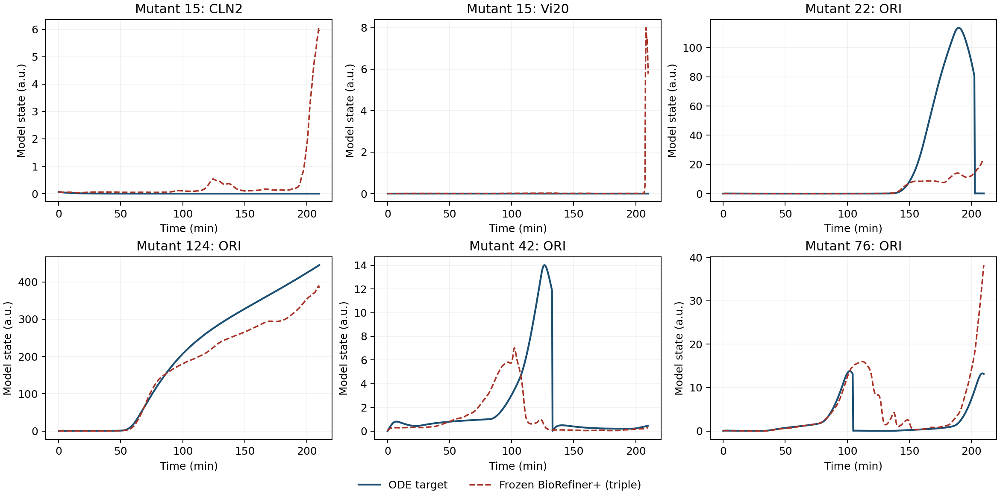

# Pure-random bad case 当前证据审计（2026-10-18）

> **后续状态**：下文保留修复前证据与历史结果。同日按用户要求已修复 IC 布局和
> WT 特征表示问题（包括复制该逻辑的 Dynamic/Latch 适配器），图/采样/ODE/损失未改，
> 没有启动训练。当前审计探针将分别输出修复结果与 `legacy_*` 对照，
> 见 [修复、测试与 checkpoint 迁移说明](IC_WT_CONTRACT_FIX_2026-10-18.md)。

## 范围与复现来源

审计代码版本：`24b8799ef6af05031798fb877f8e2697e7505bf4`。
数据源仅为实际 `mutant_aware_pure_random_100000_210m_500s.npz`、对应实验目录的
CSV/JSON、冻结 checkpoint 与当前源代码。**这是事后诊断，不是训练采样器**：
测试参数和轨迹只用于解释已有误差，不能用来设定采样中心、范围、门控阈值或模型选择。
不采用 real-rule-guided/target-aware 增广。

已完整阅读新版 `AGENTS.md`。所有新分析代码位于
`scripts/analysis/dataset_diagnosis/`，输出位于
`scripts/analysis/outputs/pure_random_current_audit/`，未修改生产模型、损失、采样器、
训练或评估入口，也未启动新训练。

参考运行是 `biom_refiner_plus/triple_dynamic_none/w192_m24_b256_ep100_lr8.8e-4_wm8/seed_42`。
输入拆分为 100,000 合成样本、126 real mutants；按 DataModule 的 seed=42 逻辑，
合成 train/val/test 分别为 **79,998 / 10,001 / 10,001**。

复现命令（仓库根目录执行，解释器使用 `neuralop`）：

```bash
python scripts/analysis/dataset_diagnosis/analyze_pure_random_badcases.py \
  --output-dir scripts/analysis/outputs/pure_random_current_audit/joint

python scripts/analysis/dataset_diagnosis/audit_pure_random_evidence.py \
  --plot \
  --replay-ckpt 'experiments/mutant_aware_pure_random_100000_210m_500s/biom_refiner_plus/triple_dynamic_none/w192_m24_b256_ep100_lr8.8e-4_wm8/seed_42/checkpoints/best-epoch=91-val_loss_lhs=0.0348.ckpt' \
  --replay-ckpt 'experiments/mutant_aware_pure_random_100000_210m_500s/biom_refiner_plus/hybrid_mse_rel_none/w192_m24_b256_ep100_lr8.8e-4_wm8/seed_42/checkpoints/best-epoch=99-val_loss_lhs=0.0351.ckpt'

# 单独输出，避免覆盖上一步含 checkpoint 信息的 audit.json
python scripts/analysis/dataset_diagnosis/audit_pure_random_evidence.py \
  --input-duplicates \
  --output-dir scripts/analysis/outputs/pure_random_current_audit/input_duplicate_check

python scripts/analysis/dataset_diagnosis/audit_ode_labels.py \
  --workers 4 --timeout 5 --future-timeout 35 --rtol 1e-4 1e-6 1e-8 \
  --predictions scripts/analysis/outputs/pure_random_current_audit/triple_dynamic_predictions.npz

# 最后汇总所有已完成的探针，不再运行模型或重新解压完整数据
python scripts/analysis/dataset_diagnosis/audit_pure_random_evidence.py --summary-only

python scripts/analysis/dataset_diagnosis/audit_training_contracts.py \
  --comparison-checkpoint 'experiments/mutant_aware_pure_random_100000_210m_500s/biom_refiner_plus/hybrid_mse_rel_none/w192_m24_b256_ep100_lr8.8e-4_wm8/seed_42/checkpoints/best-epoch=99-val_loss_lhs=0.0351.ckpt'
```

第二条命令流式解压 `data.npy`，使用全部合成样本重建历史 log1p 归一化统计量，
然后在 CPU 上严格加载两份冻结模型的全部模型权重，重放 126 个样本。
归一化累加采用 float64，历史统计量/设备规约存在小差异，因此不是位级复现：
参考模型总 MAE 为 0.05685（存档 0.05673），总 MSE 为 1.00253（存档 1.00213）；
逐样本 MAE 最大差异 0.00094、relL2 最大差异 0.00020。
逐通道占比与曲线来自该重放，排行榜数字来自原始存档 CSV。

## 1. 必须纠正的证据口径

### 1.1 pooled 指标不等于平均 mutant 指标

`utils/metrics.py` 对 `(B,V,T)` 输入先沿样本和时间拼接，再计算每变量 corr/relL2；
`per_mutant_metrics.csv` 则每次只传一个 `(V,T)`。因此二者不是可互换的统计量。

| 同一冻结运行 | MAE | MSE | 逐 mutant 平均 relL2 | pooled relL2 | 逐 mutant 平均 corr | pooled corr |
| --- | ---: | ---: | ---: | ---: | ---: | ---: |
| BioRefiner+ / triple_dynamic | 0.05673 | 1.00213 | 0.07408 | 0.11978 | 0.86051 | 0.98249 |
| BioRefiner+ / hybrid_mse_rel | 0.08691 | 5.18461 | 0.14266 | 0.15182 | 0.84634 | 0.97228 |

所以 pooled corr=0.98249 并不能证明每个 mutant 的动态都预测准确。
`docs/5_BENCHMARK_AND_LEADERBOARD.md` 历史榜单混合了上述口径，并有损失名称、
MSE 数值和模型行不匹配；应以本表及原始结果文件为准。

### 1.2 当前真实归一化实现

默认 `norm_type=log1p` 实际是 `Zscore(log1p(max(Y,0)))`，参数是原始 P 的 Z-score，
**不是**文档中所写的线性 Y Z-score + P Min-Max。
归一化统计量用全部合成样本（包括合成 val/test），未用 real mutants。
后者是合成拆分的预处理边界问题，不能解释为 real 轨迹参与了这一统计步骤。

### 1.3 旧覆盖报告不适用于当前 NPZ

此前的 `real_mutants_synthetic_coverage.csv` 源自 MASS 数据集，其生成脚本仍指向
`mass_dataset_210min_500steps_dual_labels.npz`。按 mutant ID 合并到 pure-random 会产生
错误归因。先前引用的 15 号最近邻距离 1.406 等数值因此撤回。
聚合脚本已停止自动导入该表；当前几何证据全部直接从指定 NPZ 的实际训练索引计算。

当前有 56 个完整运行文件，其中两个是旧版复制目录；逐模型固定选择默认
seed=42/非 asinh/hybrid 基线，排除完全相同的结果后，得到 **47 组独立结果签名**。
“结果签名不同”并不构成独立因果重复或多 seed 验证。
描述性阈值 `MAE>0.15 OR MSE>1 OR relL2>0.25 OR corr<0.75` 标出参考模型的
**22 个样本**；51 个样本在至少一半结果组中满足该规则。
以前的 20 个样本规则没有包含 MSE，不应混为同一统计。

## 2. 最主要的绝对误差来源是 ORI 与事件时序

冻结参考模型逐通道重放结果：**ORI 占全部 126 样本总平方误差约 94.9%**。
存档中 22、124 两个 mutant 合计占总 MSE 的 **70.7%**。

| mutant | 存档 MSE | ORI 占该样本平方误差 | 观察到的主要问题 |
| --- | ---: | ---: | --- |
| 20 | 3.5483 | 91.7% | ORI 峰值被压低；下游激活/事件时序失真 |
| 22 | 32.0829 | 98.3% | 真值 ORI 峰值约 113.6，预测约 23.6；重置也未正确重建 |
| 33 | 1.8956 | 87.4% | ORI 积累幅度与 Vi20 开关共同失真 |
| 42 | 0.9476 | 36.0% | ORI、CDC20T、Vi20 各占约 29–36%，主要是耦合时序问题 |
| 76 | 1.0101 | 80.8% | ORI 重置时间偏移、后期积累过强 |
| 124 | 57.1893 | 99.3% | ORI 积累偏低；Clb2 本身仅占约 0.67% 平方误差 |

这修正了以前“124 主要是 CLB2 蛋白峰值误差”的笼统判断。
ORI 的 ODE 是
`dORI/dt = ksori*(eorib5*CLB5 + eorib2*CLB2) - kdori*ORI`，
event2（CLB2+CLB5 向下穿过 0.2）会将 ORI 重置为 0。
直接逐点预测会同时承受上游 cyclin、积分幅度和重置时间的误差。
当前 `VectorizedYeastODE.compute_residual_scores` 只覆盖生化通道 1–32，
因此该残差评分本身不约束主导平方误差的 ORI。

额外做了固定 ODE 关系的一致性探针：用预测的 CLB2/CLB5 与固定 event2 规则重新积分 ORI，
126 个样本中 85 个 ORI MSE 改善，但 124 从约 2217 升至 2783。
平均 ORI MSE 仅从 37.10 降至 35.47。用真值 cyclin 驱动的纯数值控制误差约为 0.00011。
控制组只用于验证公式与离散精度，不能用于实际预测。
**因此单独替换 ORI 输出不能解决全体坏例；必须共同处理上游 cyclin 和事件时序。**

### 2.1 训练目标与物理 MSE 的侧重点不一致

`HybridMSERelLoss` 与 `TripleDynamicLoss` 接收的都是归一化轨迹，而不是物理空间轨迹。
对当前 log1p 变换，`dz/dY = 1/(std_y*(1+Y))`，高幅值通道的绝对偏差被压缩。
将同一份冻结模型的**非负后处理预测**重新编码到训练空间后，ORI 占总平方误差
**2.07%**；在物理空间却占 **94.89%**。
结果见 `physical_vs_encoded_error.csv`。这不是未裁剪模型输出的真实训练 loss 分解，
更不是训练梯度贡献比例，但能直接说明两个误差空间的权衡不同。
不能据此简单断言 log1p 是错误的：它也在保护小幅值通道；是否需要兼顾物理幅度，
只能用不含 real 信息的合成验证消融判断。

### 2.2 全部 126 个样本的事件表面检查

对冻结预测曲线应用 ODE 的四个固定阈值/方向，用线性插值估计穿越时刻，
再与原始精度 ODE 的真实触发记录比较。**这不是训练出来的事件分类器**，
也没有用真实事件来修正预测。

| 事件 | 固定表面 | 事件数量不符的 mutant 数 | 同类型同序号匹配的平均时间 MAE / min |
| --- | --- | ---: | ---: |
| event1 分裂 | CLB2 向下穿越 0.3 | 5 | 1.91 |
| event2 ORI 重置 | CLB2+CLB5 向下穿越 0.2 | 8 | 7.87 |
| event3 检查点开关 | ORI 向上穿越 1 | 6 | 1.38 |
| event4 检查点开关 | SPN 向上穿越 1 | 8 | 1.02 |

时间均值只对可匹配的事件计算，不能代替漏报/多报统计；不同事件的 mutant 集合重叠。
共有 **18/126** 个样本至少一种事件数量不符，其中 **8 个未被四指标阈值标出**。
数量正确也不代表时序正确，例如 42 号。

| mutant | 真值与预测的关键差异 |
| --- | --- |
| 15 | 真值无事件；预测在约 207.43 min 产生 ORI 向上穿越 1 |
| 20 | 真值分裂/ORI 重置约在 198.55/200.08 min；预测两者均缺失 |
| 22 | 真值分裂/ORI 重置约在 201.73/202.76 min；预测两者均缺失 |
| 33 | 事件数量相同；首次分裂从 192.41 min 提前到约 181.80 min |
| 42 | 分裂从 131.11 提前到约 105.53 min，ORI 重置从 132.94 提前到约 107.10 min |
| 76 | 真值 1 次分裂/1 次 ORI 重置；预测 3 次/4 次，并非单一相位平移 |
| 124 | 真值约 4.39 min 的 ORI 重置未在预测中出现；同时存在严重幅度偏差 |

完整记录在 `ode/predicted_event_consistency.csv`，保留所有真值/预测事件及漏报、多报列。

### 2.3 训练损失的具体监督范围与评估 relL2 不一致

新增 `audit_training_contracts.py` 先核对历史来源：参考 checkpoint 的
`hyper_parameters.loss_type=triple_dynamic`，日志 ModelSummary 也记录
`TripleDynamicLoss`。`config.json` 对应 commit 为 `64f2608`；将该版本和当前版本
的 `RelativeL2Loss`、`HybridMSERelLoss`、`TripleDynamicLoss` 做 AST 对比，
除兼容性 `**kwargs` 外数值实现一致。历史非 LHS 拆分与当前审计使用的
按 Pattern 分组、seed=42 洗牌及 ceil 配额一致。
checkpoint 回调实际监控 `val_loss_lhs`，不是 `test_real`；不能将这里的选权机制
指认为按真实测试 loss 自动选 checkpoint。

**参考模型并未启用显式事件分支：** 严格加载参考权重后，Stage 1 实际类为
`BioMechPathwayOnly`，`use_event=False`、`event_trigger=None`、`use_titration=False`。
不能因为架构名字含 “mechanistic”，就认为它已经执行了 ODE 的事件触发/重置规则。
该结构事实与先前事件错误一致，但不是修复收益的受控证明；权重本身均为有限值。

**DTW 项的时域/通道盲区：**

- `::20` 对 500 点只保留索引 `0,20,...,480`，最后点为约 **202.004 min**，
  后续 **19 点**不参与此项；未取样的内点也不可见。
- 15 号 **58.32%** 的总平方误差、**88.92%** 的 CLN2 平方误差落在最后取样点之后。
  这比泛称“末端有异常”更具体，但不能证明它是唯一原因。
- DTW 使用 `[MASS,CLN2,CLB2,SIC1,C5,F2,F5,SIC1P,C2P]`，
  不含 ORI、Vi20、CDC20、CDH1 等关键事件通道，也不是评估 Core-9。
- 固定人工样例验证：只扰动最后 19 点 CLN2、未采样内点 CLN2，或全程 ORI/Vi20，
  DTW 项变化均为 **0**，但完整 TripleDynamicLoss 均上升。
  **因此“DTW 项未覆盖”不等于“MSE/导数项也不约束”。**

**训练 relative term 与最终 relL2 指标的定义不同：**

```text
训练：mean(min(||z_pred-z||₂ / sqrt(sum(z²)+0.1²), 10))
评估：mean(||Y_pred-Y||₂ / sqrt(max(sum(Y²), 0.1²*T)))
```

前者接收标准化 z，后者接收物理 Y；即使强行给相同张量，分母与截断也不同。
固定零目标、恒定误差 0.01 的人工样例：T=125/500/1000 时，前者分别为
1.118/2.236/3.162，而评估定义均为 0.1。这仅证明数学口径不一致，
不是把人工数据上的比率直接套用到真实样本。
另一个固定样例中，relative term 从 44.72 截为 10 后，该项输出梯度变为 0；
但完整 loss 的 MSE 等项仍有梯度，不能据此宣称整个模型梯度消失。

**排除过度归因：** 独立逐点动态规划与当前向量化 Soft-DTW 的前向差为 0、
梯度最大差约 4.5e-8，未发现递推算法错误。其自相似值可为负，不能把后期负训练 loss
当作权重损坏的证据。完美预测时虽然 autograd 返回非零子梯度，但完整 loss
含非光滑范数；固定输出梯度步反而使总 loss 上升，**未证明真值不是完整目标的最优点**。
以上问题应通过合成验证消融量化，不应直接宣称改一个 loss 就会改善真实测试指标。

所有输出在 `training_contracts/`，包括 `summary.json`、
`temporal_channel_support_probes.csv`、`relative_floor_probes.csv` 和
`frozen_prediction_tail_support.csv`；未更新任何模型权重。



## 3. 15 号是晚期假激活，不只是指标分母问题

15 的真值 CLN2 最大值仅为初始值约 0.06525，之后衰减；参考模型预测峰值约 6.06。
真值 Vi20 恒为 0.01，预测却在末段升至约 7.99。
该样本约 75.5% 的平方误差集中在最后 10% 时间窗；这是晚期假激活的直接证据，
是否还包含谱算子边界效应需要专门消融，不能由曲线单独断言。

同一 checkpoint 分阶段重放进一步定位到粗预测已有错误：

| 15 号指标 | 粗预测 | 精修后 | 真值 |
| --- | ---: | ---: | ---: |
| CLN2 峰值 | 4.276 | 6.060 | 0.0653 |
| Vi20 峰值 | 5.394 | 7.992 | 0.0100 |
| 全通道 MSE | 0.08382 | 0.10678 | — |

参考模型全体平均 MSE 从粗预测 2.34434 降至精修后的 1.00253，但有 18/126 个
样本反而变差，包含 15、42、76。**精修器放大了 15 的错误，却不是错误的唯一来源。**
阶段结果保存在 `triple_dynamic_stage_comparison.csv`；未重训或修改任一阶段。

它到实际训练集最近参数点的标准化距离约 0.589，而最近点为单基因 CLN2[MC]、
Pattern A；最近 20 点只有约 40% 是它自身的 Pattern C。
相近参数并不保证相同动力学分支。
在 ODE 中 CLN2 合成还要乘 SBF，不能把 MC 的合成常数增大直接等同于 CLN2 已被激活。
15 的 `ksn2pp=0.75` 相对 WT 的 0.15 是 **5 倍**，也不是历史文档所称的 120 倍。

该结论不意味着其他样本都共享同一机制：42、76 在训练集中没有样本能同时保持它们
全部为零的参数坐标；33 的最近邻距离约 3.42；这与 15 的相近但异分支邻居不同。
这些都是事后覆盖诊断，不能作为真实参数定向采样的输入。

## 4. 新增模型存在可复现的输入表示缺陷

### 4.1 IC 布局错误

DataModule 的输入布局为 `(B,39,2,T)`，每个变量内部是 `[IC,time]`。
Attractor/AttractorPlus 将其 reshape 为 `(B,78,T)` 后，前 39 个通道变为
`[IC_0,time,IC_1,time,...]`；但 `EquilibriumRelaxationStream` 将前 39 个通道
全部当作变量初值。

不依赖训练权重的标识值探针：

```text
正确初值前六维: [1, 2, 3, 4, 5, 6]
平原分支 t=0 : [1, 0, 2, 0, 3, 0]
39 个初值中 38 个错位
```

相同错误也出现在 AttractorPlus 的容量门控基线 `x_0` 提取中。
位置：`bio_refiner_attractor.py:74`，`bio_refiner_attractor_plus.py:139,167`；
`bio_refiner_causal_reach.py:266` 的容量基线也有相同布局问题。
这是确定的实现缺陷；它对最终指标的因果贡献仍需修复后的受控重训验证。

### 4.2 因果门控的 WT 参考值与输入不在同一表示空间

`CausalReachabilityGate.forward`（`bio_refiner_causal_reach.py:109–114`）与
`CausalMutantAdapter.forward`（`bio_refiner_causal.py:392–397`）计算
`delta_p = p - p_wt`。但 DataModule 传入的是 P 的 Z-score，`WT_VALUES_141`
则是未经标准化的物理参数；模型内部没有相应的反归一化/参考值变换。

WT-only 探针只用默认 WT 和合成统计量，**不需要 real-mutant 参数**：
默认物理 WT 与硬编码表逐项完全相等，但正常标准化后与该物理表相减的 L2 范数
约 **237.35**，并非零。例如 `kasrent` 的输入约 0.2216，却减去 200；
`mdt` 的输入约 -1.0541，却减去 90。
因此所谓“相对 WT 干预”并没有按注释的物理意义编码。
输出为 `causal_wt_reference_probe.csv` 与 `causal_wt_reference_summary.json`。
这不是参数索引错位的证据，也不能把给冻结权重直接改喂物理 P 当成有效修复实验。

### 4.3 无分裂不等于所有通道已到平衡点

另一个建模假设需要修正：Pattern C 只表示 210 min 内没有检测到分裂，
不表示 39 个变量都处在不动点。15 的 MASS 从 1.206 增长至 6.078，
符合无分裂时的指数增长。`HybridBifurcateLoss` 对所有 Pattern C 通道施加末段平坦约束，
并不能普遍解释为物理上正确的 arrest 约束。

### 4.4 两个主力 checkpoint 的图先验实际退回了单位矩阵

这不是仅从当前构造函数猜测：两个已重放 checkpoint 的
`model.stage2_refiner.graph_attn.graph_bias` 都是 **39×39 单位矩阵**，
非对角非零数为 **0**；仓库实际 `data/yeast_signed_adjacency_matrix.npy`
的非对角非零数为 **218**。

`StoichiometricGraphAttention.__init__` 使用相对路径
`budding_yeast_v2/data/yeast_signed_adjacency_matrix.npy`。
而 `run_pipeline.sh` 首先切到仓库自身目录，从那里此路径不存在；实际文件位于
`data/yeast_signed_adjacency_matrix.npy`。未显式传 `adj_matrix` 时会静默使用
`np.eye(num_vars)`。这两个运行的 `config.json` 均为 `adj_matrix_path=None`。
该路径与回退机制可以复现；保存在 checkpoint 的单位矩阵则直接证明这两个权重
没有保存预期的跨变量图偏置。

注意：forward 仍执行全连接 QK softmax 注意力，单位矩阵只改变结构偏置，
**不代表模型没有学习到任何跨变量关系**。这里也不是硬因果掩码。
不能把参考 `BioRefinerPlus` 误述为已使用动态多关系通量图的 `BioRefinerGraphFlux`。
未来修正加载路径后应重新训练/做合成验证消融，不能直接替换冻结 buffer 再当成修复已验证。
两个权重的实测图统计均在 `training_contracts/summary.json` 的 source/comparison_sources 中。

## 5. 严格盲测约束仍有已确认的代码违例

这些问题不会解释无 AL 基线的全部误差，但会使“无泄漏改进”的主张失效：

1. `utils/al_callback.py:3561` 的公共 `_build_broadcast_from_pool` 从
   `dm.test_dataset_real` / `dm._Y[dm._test_idx_real]` 提取轨迹最大值，构造
   `dynamic_thresholds`，再决定哪些合成轨迹进入训练。残差等评分路径也采用相同的
   real envelope。候选池没有预存 Y 并不能防止这种测试标签泄漏。
2. `utils/ode_residual_engine.py:252` 的 `check_nominal_flux_mask` 明确将合成速率阈值
   标记为取自 126 real mutants 的最大值；硬编码也仍有测试信息来源问题。
3. `generate_pure_random_dataset.py` 在保留/拒绝训练候选时调用
   `is_duplicate_real_mutant`；`mutant_aware.sample_scaling_factor` 的若干边际区间注释
   也明确依据 real anchors 调整。按本项目用户要求，这些来源都必须从训练设计中剥离。

将 real 样本放在同一文件并最终划入 test_real，本身不能证明发生了梯度泄漏；
以上结论依据的是实际影响采样的读取路径，不能混淆。

此外，现存 NPZ 已发现 3 个 real 样本与训练集完整输入、完整标签重合，详见下一节。
当前去重代码可以复现一个相关漏洞：MAD2[CSL] 写入 `Vi20=0.01` 和
`Vi20_active=0.01`，真实规则只有后者；额外字段导致字典去重返回 False，
但 `simulate_mutant` 将两者折算为同一动力学。删除冗余字段，去重检查就返回 True。
复现保存在 `dedup_alias_probe.json`。这是当前代码的可复现漏洞，不能在缺少原始
生成版本记录时推断所有历史候选的具体生成过程。
在本项目严格盲态约束下，**不能把修复 real 字典黑名单作为训练设计**；
字典比较仅用于本次事后审计。

## 6. 其他复现与解释风险

- 100k 合成参数只有 85,061 个唯一向量。已进一步流式检查 float32 P、实际 IC 变换
  与完整 39×500 轨迹的 SHA-256，不再仅是参数重复候选：

  | 测试/验证拆分 | 总样本数 | 与训练集完整输入和完整标签均相同 |
  | --- | ---: | ---: |
  | 合成验证 | 10,001 | 1,633（16.33%） |
  | 合成测试 | 10,001 | 1,604（16.04%） |
  | real 测试 | 126 | 3：78、112、114 号 |

  这是输入重复的下界，未计进一步归一化舍入造成的碰撞。
  该重合会影响“未见样本泛化”的解释，但不能解释 15、20 等无精确重合坏例的高误差，
  也不证明这 3 条是故意拷贝而来。详情见
  `input_duplicate_check/duplicate_inputs.csv` 与 `duplicate_inputs_summary.json`。
  合成拆分可在不读取任何 real 参数的前提下按规范化 `(P,IC)` 分组隔离。
- `generate_pure_random_dataset.py` 的局部 RNG seed 未控制被调用函数里的全局
  `np.random`。固定局部 seed=42、改变全局 seed，前 20 个候选有 16 个不同。
- 实际 NPZ 的 L1–L4 各有 25,000 条，但动力学类型并不均衡：
  L4 的 21,309 条（85.24%）是 Pattern C，多次分裂 Pattern A 只有 503 条（2.01%）；
  实际训练拆分的 L4/Pattern A 仅 399 条。全体合成中 Pattern A 占 6.33%，
  real 中为 16.67%（后者仅供事后对比，不能用于设定未来训练配比）。
  因此“突变数量均分”不等于“复杂组合的周期动力学覆盖充分”。
  合成训练中 141 参数仅 83 个坐标的 std>1e-6；额外核查未发现 real 参数在其余
  恒定坐标上出现 >1e-7 的偏离，所以不能把恒定坐标失配当作当前坏例的通用解释。
  计数见 `training_contracts/level_pattern_counts.csv`。
- corr 对恒定/微幅通道有特殊含义：WT 的三个恒定通道使其逐样本 corr 即使接近完美
  也不会稳定接近 1。应补充动态通道 corr、绝对误差与事件指标，同时保留原始指标。
- `TripleDynamicLoss.core_indices=[0,1,2,4,7,8,9,10,11]` 与评估 Core-9 的
  `[0,1,2,3,4,20,22,33,35]` 不同；应明确这是否为设计选择，不能称为同一 Core-9。
- real-mutant `data` 数组仍是对文献突变规则调用同一 ODE 得到的轨迹。当前代码能证明
  的任务是对实验来源突变规则的 ODE 轨迹泛化，不能直接等同于原始实测浓度轨迹预测。

## 7. 数值积分负对照：未发现 real 标签求解失败是主要原因

重新求解全部 126 个 real mutants，只写入诊断指标与求解器事件记录，
**不产生或追加训练数据**。原始 rtol=1e-4 控制与文件轨迹近乎一致：

| 求解器 rtol | 成功数 | 对文件轨迹平均 MAE | 最大单样本 MAE | Pattern 改变/未积分到 210 min/失败段 |
| --- | ---: | ---: | ---: | --- |
| 1e-4 | 126 | 1.84e-8 | 1.76e-7 | 0 / 0 / 0 |
| 1e-6 | 126 | 0.000221 | 0.001418 | 0 / 0 / 0 |
| 1e-8 | 126 | 0.000238 | 0.001604 | 0 / 0 / 0 |

所有容差下事件类型序列也保持一致。15 号高精度标签与文件的 MAE 约 0.000054，
远小于模型的 0.07154；124 号为约 0.001604，而模型为 0.99897。
因此当前 real 坏例的主要误差不能归因于标签求解器崩溃、截断或容差噪声。
此检查**不等于**已经验证全部 100k 合成标签均数值可靠。
复现结果见 `ode/ode_label_audit.csv` 与 `ode/summary.json`。

## 8. 全体清单与不同类型坏例

`per_mutant_diagnostic_summary.csv` 覆盖全部 **126** 个样本；
`flagged_mutant_diagnostic_summary.csv` 是固定四指标规则标出的 **22** 个样本，
联合存档指标、通道误差、初值常量、邻居分支、零面覆盖、分阶段预测、事件缺失/多报，
以及完整输入/标签重合标记。以下分组只是**描述观测**，不是通过重训证明的因果类别：

| 参考模型的 22 个标记样本 | ID | 主要观测 |
| --- | --- | --- |
| ORI 占平方误差 >50%（16 个） | 20、22、23、24、33、44、50、53、58、59、62、71、75、76、105、124 | 同时包含幅度偏差、漏重置与事件时序偏移，不能全部归为一种分岔错误 |
| 只有 corr 触发规则（3 个） | 13、32、64 | MAE 分别约 0.0070/0.0172/0.0104；非恒定通道 corr 约 0.876/0.914/0.882，明显高于原始全通道 corr |
| 其他主导误差（3 个） | 15、37、42 | 15 晚期 CLN2/Vi20 假激活；37 的 CDC20T 占平方误差 99.8%；42 是 ORI/CDC20T/Vi20 的耦合时序偏差 |

例如 50、71、75 的动态通道 corr 约 0.959、0.993、0.992，仍有明显原始 MSE：
这类样本更像大幅值积分通道误差，不能与 15 的动态分支错误混称“波形全错”。
辅助动态 corr 的定义保存在 `joined_evidence_summary.json`，原始四指标没有被替换。
跨 47 组结果签名的 51 个高频标记样本清单仍由 `joint/` 报告提供，
这里对通道和阶段的重放解释限于明确列出的两个 BioRefinerPlus checkpoint。

## 后续工作优先级

1. 在后续获授权的修复中，先处理确定的 IC 提取、WT 表示空间与图文件加载错误；
   其中 IC/WT 问题属于新增 Attractor/Causal 系列，图加载问题则已在两个主力
   BioRefinerPlus 权重中确认；不能把它们混成所有模型共有的同一根因。
   同时移除采样/AL 的 real envelope、real anchor 等信息来源。
2. 仅用合成训练数据建立分组隔离的 train/val/test，归一化仅拟合 train；
   用合成验证决定配置，禁止依据 real 参数/指标构造训练邻域或调节阈值。
3. 在预先声明的公共 ODE 规则下，受控验证 cyclin–ORI–event 联合建模及
   归一化目标/物理幅度目标的权衡，不按测试 mutant ID 增广，也不强迫所有 Pattern C 通道平坦。
4. 保留 pooled 与 macro 两套指标，补充动态通道 corr、事件及误差尾部指标；
   多 seed 后再判断是否能同时改善四指标与坏例。历史 real 结果已用于分析，
   后续在同一测试集上的迭代只能称开发性结果；确认性结论需要新的独立盲测。

目前只证明了以上缺陷和误差结构；**尚未证明任何新训练方案同时提升全部指标**。
